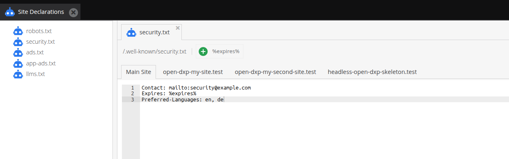

# Site Declarations

> [!CAUTION]
> To use this feature, please enable the `OpenDxpSeoBundle` in your `bundle.php` file and install it accordingly with the following command:
>
> `bin/console opendxp:bundle:install OpenDxpSeoBundle`

A site declaration is a text file that every site serves under the same path. Editors maintain its content per site
under *Marketing > Search Engine Optimization > Site Declarations*.



| Name           | Path                        | Enabled by default |
|----------------|-----------------------------|--------------------|
| `robots_txt`   | `/robots.txt`               | yes                |
| `security_txt` | `/.well-known/security.txt` | no                 |
| `ads_txt`      | `/ads.txt`                  | no                 |
| `app_ads_txt`  | `/app-ads.txt`              | no                 |
| `llms_txt`     | `/llms.txt`                 | no                 |

## Enable a site declaration

An enabled site declaration owns its path on every site. A document, a static route or a route of your own under the
same path no longer answers. Enable a site declaration in the configuration:

```yaml
opendxp_seo:
    site_declarations:
        security_txt: true
        robots_txt: false
```

A disabled site declaration has no route. Its path answers as if the site declaration did not exist.

## Edit a site declaration

The permission `site_declarations` allows a user to edit every site declaration. The editor shows a tab for the main
site and for every other site.

A site without content of its own gets the default content of the site declaration. Only robots.txt has one:

```
User-agent: *
Disallow:
```

Every other site declaration answers 404 for a site without content.

A file under the same path in the `public` folder wins over the site declaration, because the web server delivers it
before OpenDXP. The editor then disables saving.

## Placeholders

A site declaration can offer placeholders. The editor shows them above the text field. A click inserts the placeholder
at the cursor. The response replaces each placeholder with its current value.

## security.txt

security.txt follows [RFC 9116](https://www.rfc-editor.org/rfc/rfc9116). 
The editor refuses content without `Contact`, without `Expires` or with more than one `Expires`.

The placeholder `%expires%` turns into a date 364 days after the day of the request. The file therefore never expires:

```
Contact: mailto:security@example.com
Expires: %expires%
Preferred-Languages: en, de
```

A fixed date stays as it is. A signed file needs a fixed date.

## Sites

Every site has its own content. A site without content does not fall back to the content of the main site. A host
without a site gets the content of the main site.

## Caching

The response carries `Cache-Control: private, no-store`. Neither the full page cache nor a proxy keeps it, so a saved
change applies at once.

## Add a site declaration

A bundle adds a site declaration with a service that implements
`OpenDxp\Bundle\SeoBundle\SiteDeclaration\SiteDeclarationInterface`. Autoconfiguration registers it.

```php
use OpenDxp\Bundle\SeoBundle\SiteDeclaration\SiteDeclarationInterface;

final class AppleAppSiteAssociationDeclaration implements SiteDeclarationInterface
{
    public function getName(): string
    {
        return 'apple_app_site_association';
    }

    public function getPath(): string
    {
        return '/.well-known/apple-app-site-association';
    }

    public function getContentType(): string
    {
        return 'application/json';
    }

    public function getDefaultContent(): ?string
    {
        return null;
    }

    public function getPlaceholders(): array
    {
        return [];
    }

    public function validate(string $content): array
    {
        return [];
    }
}
```

The project enables the site declaration in its configuration. A name that is not snake case, a name used
twice or a path used twice fails when the cache is built.
