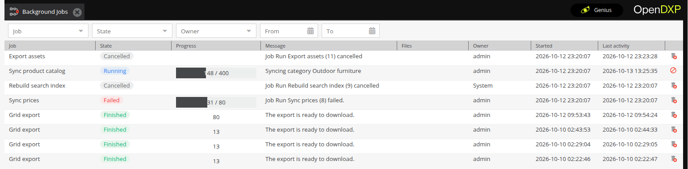

# Generic Execution Engine
:::caution

To use this feature, please update your `composer.json` by requiring `phpdocumentor/reflection-docblock` and `symfony/property-info` like in the `suggest` section. Enable the `OpenDxpGenericExecutionEngineBundle` in your `bundles.php` file and install it accordingly with the following command:

`bin/console opendxp:bundle:install OpenDxpGenericExecutionEngineBundle`

:::

The Generic Execution Engine shows background work as job runs in the admin. A job run has a state, a progress,
errors and a result. Work becomes a job run in two ways:

- The engine runs a [job](01_Jobs_and_Jobruns/01_Jobs.md). A job has steps, and the engine dispatches a message for
  each step and selected element.
- The engine tracks your own code. See [Track Background Work](01_Jobs_and_Jobruns/03_Track_Background_Work.md).

Both ways lead to the same [job runs](01_Jobs_and_Jobruns/02_JobRun.md). The admin shows them, a user cancels them, and
the engine cleans them up.

## See what runs

The admin lists job runs under "Extras" > "Background Jobs":

- A double click on a job run opens its log with its errors.
- A running job run can be cancelled. An ended one can be deleted.
- The files of a job run are offered for download.
- The permission "Background Jobs" opens the list with the own job runs. With "See all Background Jobs", a user sees
  every job run, also those without an owner.

An icon in the sidebar shows the own job runs to every user, also without a permission:

- A counter shows how many of them run.
- The menu of the icon shows their progress and lets the user cancel them.
- A finished job run of a disposable context stays in the menu until the user downloads its files or removes it.
- The admin reports the end of each job run with a notification. A job run started from this browser tab hands over
  its files as a download at once.

> [!CAUTION]
> The engine dispatches the messages of a job through the transport `opendxp_generic_execution_engine`. Run a worker
> for this transport, for example `bin/console messenger:consume opendxp_generic_execution_engine`. Without a worker,
> a job does not start its steps.
